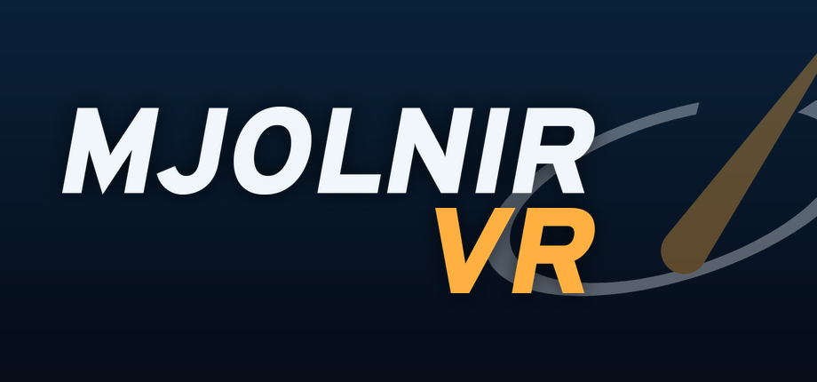

  

# Mjolnir VR

**A VR mod for Halo: Combat Evolved** (the original Xbox game) on the
**Meta Quest 3 / 3S** and the **Steam Frame**. Play the campaign and
multiplayer in full 6DoF virtual reality, with your hands in the game.

Mjolnir VR runs on your headset by itself, without a PC. It
brings no game files: it uses a disc image of **your own, purchased copy**
of the game.

> **Unofficial fan project.** Mjolnir VR is a free,
> non-commercial fan project. It is not affiliated with, endorsed,
> sponsored or approved by Microsoft, Xbox Game Studios, Halo Studios or
> Bungie. See [Legal](#legal).

Until build 313 it was called *Ringfall: Mjolnir VR*. Installed builds
update to the new name by themselves, and the old links lead here.

## Contents

- [What you get](#what-you-get)
- [What you can play](#what-you-can-play)
- [What you need](#what-you-need)
- [Install on Meta Quest 3 / 3S](#install-on-meta-quest-3--3s)
- [Install on Steam Frame](#install-on-steam-frame)
- [Playing](#playing)
- [Problems and questions](#problems-and-questions)
- [Credits](#credits)
- [Legal](#legal)

## What you get

- **Full VR**: stereo 6DoF at your headset's refresh rate (72 to 120 Hz);
  the HUD, menus, scope and crosshair float as layers of their own.
- **Your hands in the game**: the weapon sits in your hand and fires
  where you point it; arms and fingers follow your controllers;
  two-handed weapons, melee by swinging, grenades thrown with your hand,
  crouching and leaning with your body.
- **Vehicles**: steer the Warthog by turning its wheel with both hands;
  turrets with handles.
- **Comfort**: snap or smooth turning in fine steps, comfort vignettes,
  left-handed mode, buttons remapped freely, graphics presets, refresh
  rate and resolution, all in the in-game VR options (**Y**).
- **The PC version's menus**, clicked with a laser pointer, and an
  on-screen keyboard for names, codes and passwords.

## What you can play

- **The whole campaign**: all ten missions, on every difficulty, saved as
  you go.
- **Co-op campaign** with friends, online or on your local network, with
  settings for friendly fire and extra enemies per player.
- **LAN multiplayer** (system link) with everyone on your network.
- **Online multiplayer**, no server of your own needed: host a game and
  share its join code, find public games in the server browser, or protect
  a lobby with a password. Up to 128 players.
- **Bots** to fill a game, on foot, in vehicles and at turrets; they make
  room when a person joins.
- **All 13 multiplayer maps** and the Xbox game's game types: Slayer,
  Capture the Flag, King of the Hill, Oddball and Race.
- **Cross-play**: VR players on the Quest and the Steam Frame, together with
  players of the PC and phone builds of
  [OpenCE](https://github.com/OpenCommunityEdition/OpenCE).

## What you need

- A **Meta Quest 3 / 3S** or a **Steam Frame**.
- A **disc image** (`.iso` or `.xiso`) of **Halo: Combat Evolved for the
  original Xbox**, made from **a disc you own**. Any region and version
  works. The game plays in the disc's language; on the European disc in
  Spanish and Italian it takes your headset's language (else the first).

This project does not include, link to or help find game files. Please
do not ask for or share disc images in issues or discussions; such posts
are deleted.

## Install on Meta Quest 3 / 3S

You install the game once with a computer (Windows, macOS or Linux); after
that it updates itself.

1. **Turn on Developer Mode** for your Quest, once: in the Meta Horizon
   app on your phone, open your headset's settings, then *Developer
   Mode* (Meta asks you to create a free developer account first).
2. **Install [SideQuest](https://sidequestvr.com/setup-howto)** (the
   "Advanced Installer") on your computer and connect the Quest with a
   USB cable. In the headset, allow USB debugging for this computer.
3. **Download `MjolnirVR.apk`** from the
   [latest release](../../releases/latest) and drag it onto the SideQuest
   window. It installs the game.
4. **Copy your disc image** to the Quest's `Download` folder: in
   SideQuest, open the file manager (the folder icon), go to `Download`
   and drag the `.iso` file in.
5. **In the headset**, open your *Library*, choose *Unknown Sources* and
   start **Mjolnir VR**. Select **Choose disc image** and pick
   your file in `Download`. The game copies what it needs (about 1.8 GB,
   a minute or two) and starts.

You can delete the disc image from `Download` afterwards. When a new
version comes out, the game asks you at start whether to update.

## Install on Steam Frame

No computer and no keyboard needed.

1. **Switch to Desktop Mode**: press the Steam button, then *Power* >
   *Switch to Desktop*.
2. **Put your disc image** in the `Downloads` folder (for example from a
   USB stick or memory card with the file manager, Dolphin).
3. **Download `Install-Mjolnir-VR.desktop`** from the
   [latest release](../../releases/latest) with the web browser.
4. **Open it**: in Dolphin, open `Downloads` and double-click the file.
   If you are asked whether to run it, choose to continue.
5. **Answer the dialogs.** The installer finds your disc image, copies
   what the game needs, adds **Mjolnir VR** to your Steam
   library and offers to switch back to Gaming Mode.
6. Start **Mjolnir VR** from your library (under *Non-Steam*).

The game updates itself: when a new version is out, it is downloaded
while you play and used from the next start on. Your settings, saves and
game data stay. More about the Steam Frame:
[port/android/STEAM_FRAME.md](port/android/STEAM_FRAME.md).

## Playing

- **Y** opens the VR options in the main and pause menus: turning,
  comfort, weapon hand, buttons, graphics, refresh rate and resolution.
  *Quit the game* is on its last page.
- In the menus, point with a controller and pull the trigger to click.
- The controller layout is on the VR options' *Controller buttons* page.
- **Voice chat** in network games: hold the grip of the hand without the
  weapon to talk (not while it holds the weapon or the Warthog's wheel).
  The *BUTTONS* page can put push to talk on another button.

## Problems and questions

Please open an [issue](../../issues) and include:

- your headset and the build number of the release you installed;
- what you did and what happened;
- the game's log, `debug.txt`:
  - Quest: `Android/data/io.github.cesarus85.ringfall/files/debug.txt`
    (SideQuest's file manager);
  - Steam Frame: `Documents/RingfallMjolnirVR/debug.txt` (and
    `logcat.txt` and `install.log` beside it).

What is done and what comes next: [port/android/VR_ROADMAP.md](port/android/VR_ROADMAP.md).

**Network use.** The game connects to the internet only for what you
use: the update check (GitHub), online games (to other players
directly), and join codes and lobby lists through public MQTT brokers
(listed in [brokers.txt](port/assets/network/brokers.txt)). There is no
telemetry.

## Credits

Mjolnir VR stands on the work of others:

- **[OpenCE](https://github.com/OpenCommunityEdition/OpenCE)** (Open
  Community Edition): the port of the decompiled game to Linux, Windows
  and Android, with its renderer, netcode, PC menus and multiplayer, that
  this project builds on and follows.
- **The decompilation**: [bnunu/halo-1](https://github.com/bnunu/halo-1),
  a fork of [punpckhdq/halo](https://github.com/punpckhdq/halo).
- **[HaloCE-Quest-VR](https://github.com/moistman42069/HaloCE-Quest-VR)**
  by moistman42069 (CC0): the arm IK, the forearm's twist and the
  fingers' poses are taken from it (`port/linux/game/vr_arms.c`); the
  left-handed mode and the graphics presets follow its ideas.
- **[HaloCE-VR](https://github.com/astromaddie/HaloCE-VR)** by astromaddie
  (CC0): the Steam Frame work, whose findings (such as quieting Mesa's
  trace markers) are used here.
- **[xboxdevwiki](https://xboxdevwiki.net/XDVDFS)**: its description of
  the Xbox's disc file system, which the disc image readers are written
  from.
- The libraries and fonts in [THIRD_PARTY_NOTICES.md](THIRD_PARTY_NOTICES.md).

Thank you all.

## Building it

`python3 configure.py --release`, then `ninja android_apk` (Android SDK
and NDK needed). See [port/android/README.md](port/android/README.md) for
the details and [docs/OPENCE_README.md](docs/OPENCE_README.md) for the
port it is built on.

## Legal

Mjolnir VR is an unofficial, free, non-commercial fan project.
It is not affiliated with, endorsed, sponsored or approved by Microsoft
Corporation, Xbox Game Studios, Halo Studios or Bungie. Halo, Halo: Combat
Evolved and Xbox are trademarks of Microsoft Corporation; they are named
here only to say which game this mod works with. Meta Quest is a trademark
of Meta Platforms, Inc.; Steam and Steam Frame are trademarks of Valve
Corporation.

No game data, art, music or other content of the game is included or
distributed. You need your own, legally purchased copy of the game. If
you enjoy this mod, please support the creators of the original by buying
their games.

### Licence

Mjolnir VR is free software: you can give it to others and change
it under the terms of the GNU Affero General Public License as published by
the Free Software Foundation, version 3 of the License or (at your option)
any later version (`AGPL-3.0-or-later`), as OpenCE, which it builds on, is.
It comes with no warranty. The full text is in [LICENSE](LICENSE).

- **From build 312 on.** The AGPL applies from the commit that took in
  OpenCE's change of licence (19 October 2026), and to each release built
  from it or a later one. Earlier releases, and the source at every earlier
  commit, were released under [CC0 1.0](LICENSES/CC0-1.0.txt) and stay
  that way.
- **Hosts and servers.** If you change the game and let other persons play
  with your version over a network (for example, as the host of an
  internet game), the AGPL asks you to offer them the source of your
  version. The game as released has its source here, and each release's
  source is its tag (`build-<n>`).
- **Third-party code and fonts** keep their own licences: see
  [THIRD_PARTY_NOTICES.md](THIRD_PARTY_NOTICES.md).
- **Halo is not covered.** The licence covers the work of this project's
  and OpenCE's authors. It gives no rights in Halo, its maps or anything
  else that Microsoft owns.
